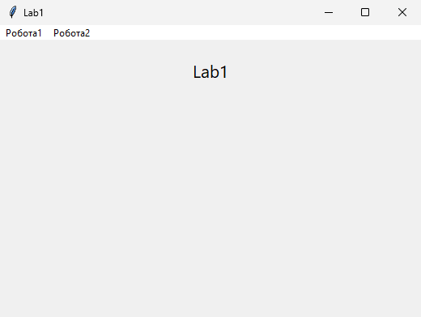
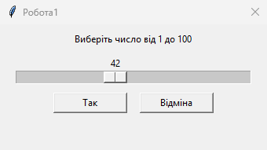
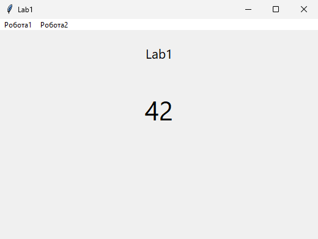
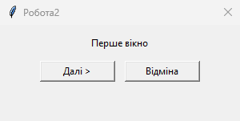
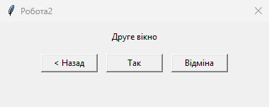

<div style="text-align: center; font-size: 24px; margin-top: 60px;">

Міністерство освіти і науки України

Національний технічний університет України

«Київський політехнічний інститут імені Ігоря Сікорського»

Факультет інформатики та обчислювальної техніки

Кафедра обчислювальної техніки

</div>

<div style="text-align: center; margin-top: 120px;">

<h1 style="font-size: 22px;">Лабораторна робота №1</h1>

<h2 style="font-size: 22px;">з дисципліни «Об'єктно-орієнтоване програмування»</h2>

<h3 style="font-size: 22px; margin-top: 20px;">на тему</h3>

<h2 style="font-size: 22px;">«Знайомство із середовищем розробки та складання модульних проєктів програм на Python»</h2>

</div>

<div style="text-align: right; margin-top: 120px; font-size: 18px;">

<strong>Виконав:</strong><br>
Кузнецов Кирило Олексійович<br>
студент групи IM-о51<br>
номер у списку групи: 5<br><br>

<strong>Перевірив:</strong><br>
Рекечинський Дмитро Олександрович

</div>

<div style="text-align: center; margin-top: 120px; font-size: 20px;">

Київ 2026

</div>

---

## Завдання

1. Створити у середовищі Microsoft Visual Studio проєкт Python з ім'ям Lab1.
2. Написати вихідний текст програми згідно варіанту завдання.
3. Запустити програму і переконатися, що вона працює.
4. Перевірити роботу програми. Налагодити програму.
5. Проаналізувати та прокоментувати результати та вихідний текст програми.
6. Оформити звіт.

---

## Завдання згідно варіанту

Мій номер у журналі Ж = 5.

В1 = Ж mod 4 = 1. Треба вікно з горизонтальним повзунком і кнопками [Так] і [Відміна]. Повзунок дає число від 1 до 100. Після [Так] це число з'являється в головному вікні. [Відміна] нічого туди не записує, лишається те, що вже було на екрані.

В2 = (Ж + 1) mod 4 = 2. Два діалогові вікна. Перше має [Далі >] і [Відміна]. Друге має [< Назад], [Так] і [Відміна]. Якщо натиснути [Далі >], перше вікно саме закривається і відкривається друге. [< Назад] закриває друге і знову відкриває перше. [Так] у цій роботі просто закриває діалог. Окремий текст у головне вікно я не виводив, у завданні для В2 = 2 його немає.

Вікон три, тому модулів теж три: `module1.py`, `module2.py`, `module3.py`, плюс головний `main.py`. Модулі один одного не імпортують. З кожного назовні стирчить тільки `run`.

---

## Вихідний текст програми

### Головний файл main.py

Меню і те, що відбувається після закриття діалогів. Для роботи1 число пишу в напис, для роботи2 ні.

```python
text1 = ""
chislo =1

def robota1():
    global text1, chislo
    r = module1.run(win)
    if r == 0:
        return
    chislo = r
    text1 = str(chislo)
    lbl.config(text=text1)

def robota2():
    while True:
        a = module2.run(win)
        if a == 0:
            return
        b = module3.run(win)
        if b == -1:
            continue
        # так і відміна просто закривають діалог
        return

menu = Menu(win)
menu.add_command(label="Робота1", command=robota1)
menu.add_command(label="Робота2", command=robota2)
win.config(menu=menu)
```

### Модуль module1.py

```python
# робота1 - горизонтальний повзунок, число 1..100

from tkinter import *

_chislo = 1
_kod = 0


def _ruh(val):
    global _chislo
    _chislo = int(float(val))


def run(parent):
    global _chislo, _kod
    _chislo = 1
    _kod = 0

    d = Toplevel(parent)
    d.title("Робота1")
    d.geometry("340x160+200+160")
    d.resizable(False, False)
    d.transient(parent)

    Label(d, text="Виберіть число від 1 до 100").pack(pady=8)

    sc = Scale(d, from_=1, to=100, orient=HORIZONTAL, length=300, command=_ruh)
    sc.set(1)
    sc.pack()

    def tak():
        global _chislo, _kod
        _chislo = int(sc.get())
        _kod = 1
        d.destroy()

    def vidmina():
        global _kod
        _kod = 0
        d.destroy()

    d.protocol("WM_DELETE_WINDOW", vidmina)

    bf = Frame(d)
    bf.pack(pady=8)
    Button(bf, text="Так", width=12, command=tak).pack(side=LEFT, padx=8)
    Button(bf, text="Відміна", width=12, command=vidmina).pack(side=LEFT, padx=8)

    d.grab_set()
    parent.wait_window(d)
    if _kod == 1:
        return _chislo
    return 0
```

### Модуль module2.py

```python
# перше вікно роботи2, кнопки Далі і Відміна

from tkinter import *

vidp = 0


def run(parent):
    global vidp
    vidp = 0

    top = Toplevel(parent)
    top.title("Робота2")
    top.geometry("300x120+220+180")
    top.resizable(False, False)
    top.transient(parent)

    Label(top, text="Перше вікно").pack(pady=12)

    def dali():
        global vidp
        vidp = 1
        top.destroy()

    def vidmina():
        global vidp
        vidp = 0
        top.destroy()

    top.protocol("WM_DELETE_WINDOW", vidmina)

    row = Frame(top)
    row.pack()
    Button(row, text="Далі >", width=12, command=dali).pack(side=LEFT, padx=6)
    Button(row, text="Відміна", width=12, command=vidmina).pack(side=LEFT, padx=6)

    top.grab_set()
    parent.wait_window(top)
    return vidp
```

### Модуль module3.py

```python
# друге вікно роботи2: назад, так, відміна

from tkinter import *

kod = 0


def run(parent):
    global kod
    kod = 0

    w = Toplevel(parent)
    w.title("Робота2")
    w.geometry("380x120+240+200")
    w.resizable(False, False)
    w.transient(parent)

    Label(w, text="Друге вікно").pack(pady=10)

    def nazad():
        global kod
        kod = -1
        w.destroy()

    def tak():
        global kod
        kod = 1
        w.destroy()

    def vidmina():
        global kod
        kod = 0
        w.destroy()

    w.protocol("WM_DELETE_WINDOW", vidmina)

    row = Frame(w)
    row.pack(pady=4)
    Button(row, text="< Назад", width=10, command=nazad).pack(side=LEFT, padx=6)
    Button(row, text="Так", width=10, command=tak).pack(side=LEFT, padx=6)
    Button(row, text="Відміна", width=10, command=vidmina).pack(side=LEFT, padx=6)

    w.grab_set()
    parent.wait_window(w)
    return kod
```

---

## Скріншоти

### Головне вікно



_Рис. 1. Головне вікно, пункти Робота1 і Робота2_

### Робота1



_Рис. 2. Діалог з повзунком, вибрано 42_



_Рис. 3. Після кнопки Так число стоїть у головному вікні_

### Робота2



_Рис. 4. Перше вікно роботи2_



_Рис. 5. Друге вікно, кнопки Назад, Так і Відміна_


_Рис. 6. Після Так у роботі2 головне вікно без нового тексту_

---

## Висновки

Я зробив програму з головним вікном і двома пунктами меню Робота1 і Робота2.
Для скролбара довго не розумів як взяти число, потім просто читаю значення повзунка і якщо натиснуто Так малюю його в вікні. Відміна старе число не затирає.
Робота2 має два вікна, можна натиснути Далі і Назад, попереднє вікно при цьому закривається само. Так у другому вікні тільки закриває діалог.
Кожне вікно лежить в окремому файлі і ці файли один одного не чіпають. Навчився робити меню і прості діалоги в tkinter.
