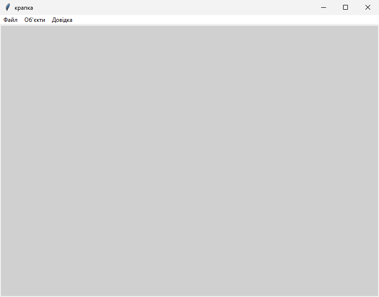
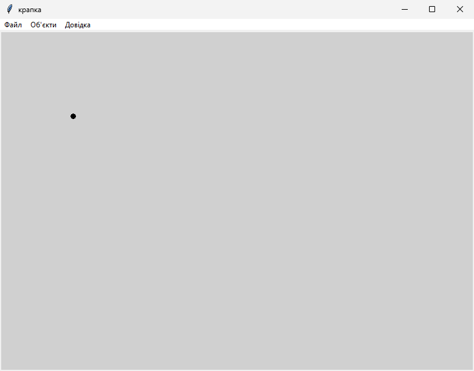
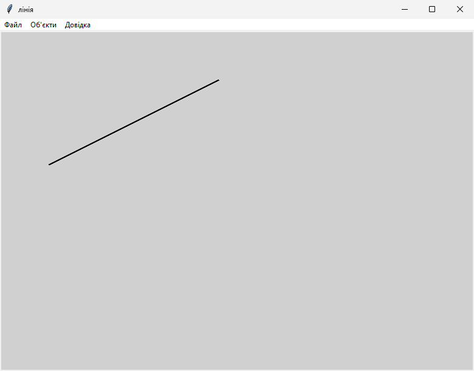
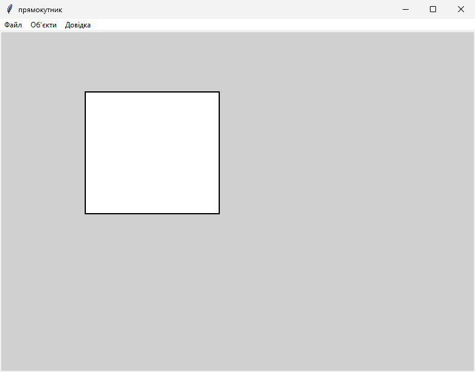
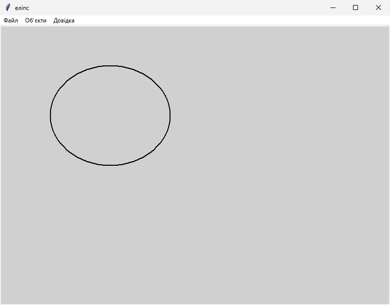

<div style="text-align: center; font-size: 24px; margin-top: 60px;">

Міністерство освіти і науки України

Національний технічний університет України

«Київський політехнічний інститут імені Ігоря Сікорського»

Факультет інформатики та обчислювальної техніки

Кафедра обчислювальної техніки

</div>

<div style="text-align: center; margin-top: 120px;">

<h1 style="font-size: 22px;">Лабораторна робота №2</h1>

<h2 style="font-size: 22px;">з дисципліни «Об'єктно-орієнтоване програмування»</h2>

<h3 style="font-size: 22px; margin-top: 20px;">на тему</h3>

<h2 style="font-size: 22px;">«Розробка графічного редактора об'єктів на Python»</h2>

</div>

<div style="text-align: right; margin-top: 120px; font-size: 18px;">

<strong>Виконав:</strong><br>
Кузнецов Кирило Олексійович<br>
студент групи IM-о51<br>
номер у списку групи: 5<br><br>

<strong>Перевірив:</strong><br>
Рекечинський Дмитро Олександрович

</div>

<div style="text-align: center; margin-top: 120px; font-size: 20px;">

Київ 2026

</div>

---
## Завдання

1. Створити у середовищі Microsoft Visual Studio проєкт Python.
2. Написати вихідний текст програми згідно варіанту завдання.
3. Запустити програму і переконатися, що вона працює.
4. Перевірити роботу програми. Налагодити програму.
5. Проаналізувати та прокоментувати результати та вихідний текст програми.
6. Оформити звіт.

---
## Завдання згідно варіанту

Мій номер Ж = 5.

Масив статичний, бо 5 mod 3 = 2. Місць N = 5 + 100 = 105. У коді це `figures = [None] * 105` і лічильник n.

Гумовий слід суцільний червоний, бо 5 mod 4 = 1.

Прямокутник вводжу від центру до кута (5 mod 2 = 1). Контур чорний, заливка біла (5 mod 5 = 0).

Еліпс вводжу по двох протилежних кутах охоплюючого прямокутника (5 mod 2 = 1). Контур чорний, без заливки (5 mod 5 = 0).

Поточний тип пишу в заголовок вікна, бо 5 mod 2 = 1. Галочки в меню немає.

Меню зліва направо: Файл, Об'єкти, Довідка. В Об'єктах зверху вниз: Крапка, Лінія, Прямокутник, Еліпс.

---

## Вихідний текст програми

### Lab2.py

```python
from tkinter import *
from tkinter import messagebox

from point import PointShape
from line import LineShape
from rect import RectShape
from ellipse import EllipseShape

# слід - червоний суцільний
figures = [None] * 105
n =0
rezhym = "крапка"
startx = 0
starty = 0
tyagnu = False

win = Tk()
win.title("крапка")
win.geometry("780x560+60+40")

c = Canvas(win, bg="#d0d0d0")
c.pack(fill=BOTH, expand=True)


def peremaluvaty():
    c.delete("all")
    for i in range(n):
        figures[i].Show(c)


def postavyty(name):
    global rezhym
    rezhym = name
    win.title(name)


def na_press(e):
    global startx, starty, tyagnu
    startx = e.x
    starty = e.y
    tyagnu = True


def na_ruh(e):
    global tyagnu
    if tyagnu == False:
        return
    c.delete("temp")
    if rezhym == "крапка":
        c.create_oval(e.x - 4, e.y - 4, e.x + 4, e.y + 4, outline="red", tags="temp")
    elif rezhym == "лінія":
        c.create_line(startx, starty, e.x, e.y, fill="red", width=2, tags="temp")
    elif rezhym == "прямокутник":
        dx = e.x - startx
        if dx < 0:
            dx = -dx
        dy = e.y - starty
        if dy < 0:
            dy = -dy
        c.create_rectangle(startx - dx, starty - dy, startx + dx, starty + dy, outline="red", width=2, tags="temp")
    elif rezhym == "еліпс":
        c.create_oval(startx, starty, e.x, e.y, outline="red", width=2, tags="temp")


def na_release(e):
    global n, tyagnu
    if tyagnu == False:
        return
    tyagnu = False
    c.delete("temp")
    if n >= 105:
        return

    if rezhym == "крапка":
        obj = PointShape()
        obj.set(e.x, e.y, e.x, e.y)
    elif rezhym == "лінія":
        obj = LineShape()
        obj.set(startx, starty, e.x, e.y)
    elif rezhym == "прямокутник":
        obj = RectShape()
        obj.set(startx, starty, e.x, e.y)
    else:
        obj = EllipseShape()
        obj.set(startx, starty, e.x, e.y)

    figures[n] = obj
    n = n + 1
    peremaluvaty()


def vyhod():
    win.destroy()


def pro_programu():
    messagebox.showinfo("Довідка", "Lab2. Кузнецов Кирило, група IM-о51")


c.bind("<ButtonPress-1>", na_press)
c.bind("<B1-Motion>", na_ruh)
c.bind("<ButtonRelease-1>", na_release)

menu = Menu(win)
m_file = Menu(menu, tearoff=0)
m_file.add_command(label="Вихід", command=vyhod)
menu.add_cascade(label="Файл", menu=m_file)

def vyb_krapka():
    postavyty("крапка")


def vyb_liniya():
    postavyty("лінія")


def vyb_pryam():
    postavyty("прямокутник")


def vyb_elips():
    postavyty("еліпс")


m_obj = Menu(menu, tearoff=0)
m_obj.add_command(label="Крапка", command=vyb_krapka)
m_obj.add_command(label="Лінія", command=vyb_liniya)
m_obj.add_command(label="Прямокутник", command=vyb_pryam)
m_obj.add_command(label="Еліпс", command=vyb_elips)
menu.add_cascade(label="Об'єкти", menu=m_obj)

m_help = Menu(menu, tearoff=0)
m_help.add_command(label="Про програму", command=pro_programu)
menu.add_cascade(label="Довідка", menu=m_help)
win.config(menu=menu)

if __name__ == "__main__":
    # ЗАПУСК (PowerShell):
    # cd C:\Users\wyxxn\Desktop\LabsOOPMain\labs\lab2
    # python Lab2.py
    win.mainloop()
```

### shape.py

```python
# базова фігура, сама нічого не малює

class Shape:
    def __init__(self):
        self.x1 = 0
        self.y1 = 0
        self.x2 = 0
        self.y2 = 0

    def set(self, x1, y1, x2, y2):
        self.x1 = x1
        self.y1 = y1
        self.x2 = x2
        self.y2 = y2

    def Show(self, c):
        pass
```

### point.py

```python
from shape import Shape


class PointShape(Shape):
    def __init__(self):
        Shape.__init__(self)

    def Show(self, c):
        r = 4
        c.create_oval(self.x1 - r, self.y1 - r, self.x1 + r, self.y1 + r, outline="black", fill="black")
```

### line.py

```python
from shape import Shape


class LineShape(Shape):
    def __init__(self):
        Shape.__init__(self)

    def Show(self, c):
        c.create_line(self.x1, self.y1, self.x2, self.y2, fill="black", width=2)
```

### rect.py

```python
# lab2, прямокутник від центру, біла заливка

from shape import Shape


class RectShape(Shape):
    def __init__(self):
        Shape.__init__(self)

    def Show(self, c):
        x1 = self.x1
        y1 = self.y1
        x2 = self.x2
        y2 = self.y2
        dx = x2 - x1
        if dx < 0:
            dx = -dx
        dy = y2 - y1
        if dy < 0:
            dy = -dy
        # центр в x1 y1
        c.create_rectangle(x1 - dx, y1 - dy, x1 + dx, y1 + dy, outline="black", fill="white", width=2)
```

### ellipse.py

```python
from shape import Shape


class EllipseShape(Shape):
    def __init__(self):
        Shape.__init__(self)

    def Show(self, c):
        # два кути охоплюючого прямокутника, без заливки
        c.create_oval(self.x1, self.y1, self.x2, self.y2, outline="black", width=2)
```

---

## Діаграми

### Діаграма класів

```
Shape
  x1, y1, x2, y2
  set(x1, y1, x2, y2)
  Show(canvas)
        |
   +----+----+----+
   |    |    |    |
 Point Line Rect Ellipse
```

Головне вікно тримає масив і в циклі кличе Show. Який клас всередині, вікно не розбирає.

---

## Скріншоти

### Рис. 1. Головне вікно, у заголовку тип фігури




_Рис. 1. Головне вікно, у заголовку тип фігури_

### Рис. 2. Крапка




_Рис. 2. Крапка_

### Рис. 3. Лінія




_Рис. 3. Лінія_

### Рис. 4. Прямокутник від центру, біла заливка




_Рис. 4. Прямокутник від центру, біла заливка_

### Рис. 5. Еліпс по двох кутах, без заливки




_Рис. 5. Еліпс по двох кутах, без заливки_

---

## Висновки

Зробив редактор на чотири фігури. Масив статичний на 105, коли місце кінчається нові вже не кладу.
Слід під час протягування червоний і суцільний. Прямокутник рахую від центру, всередині білий, еліпс просто між двома кутами і порожній.
Тип фігури міняю з меню Об'єкти і відразу бачу його в заголовку вікна.
У циклі перемальовки викликаю тільки Show, тому крапка і еліпс для вікна однакові. На цьому і є поліморфізм у цій лабі.
