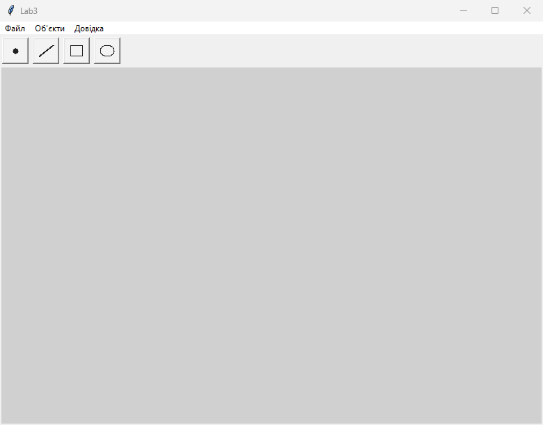
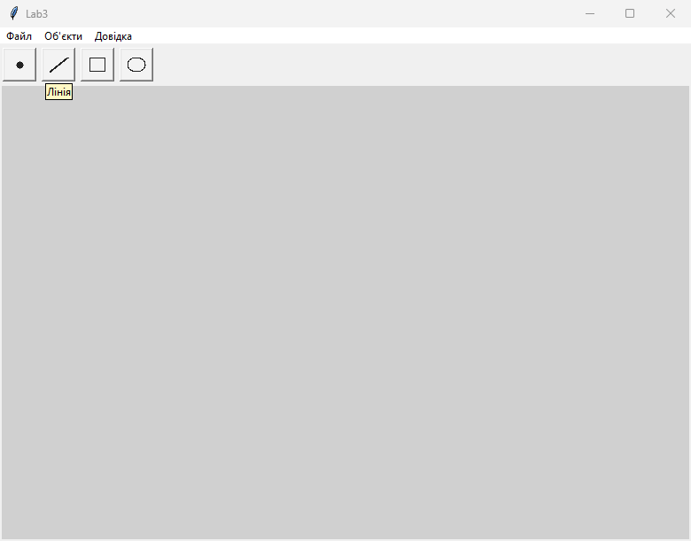
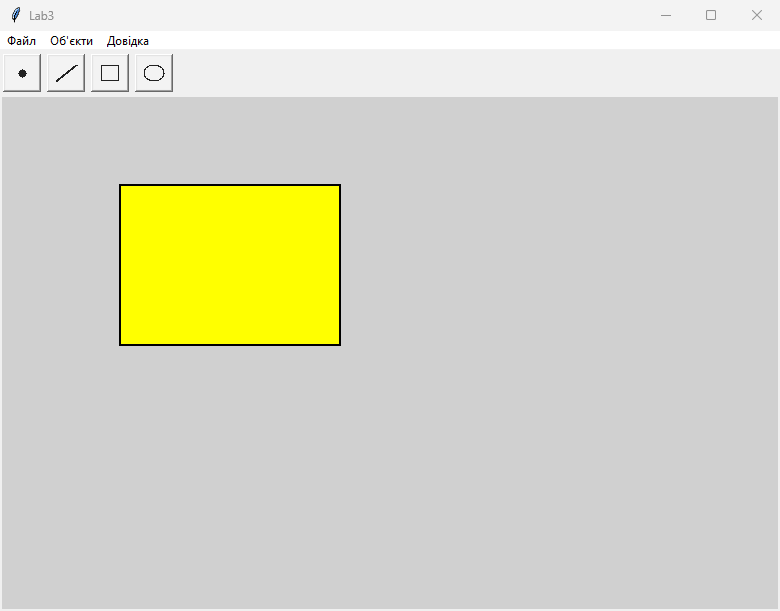
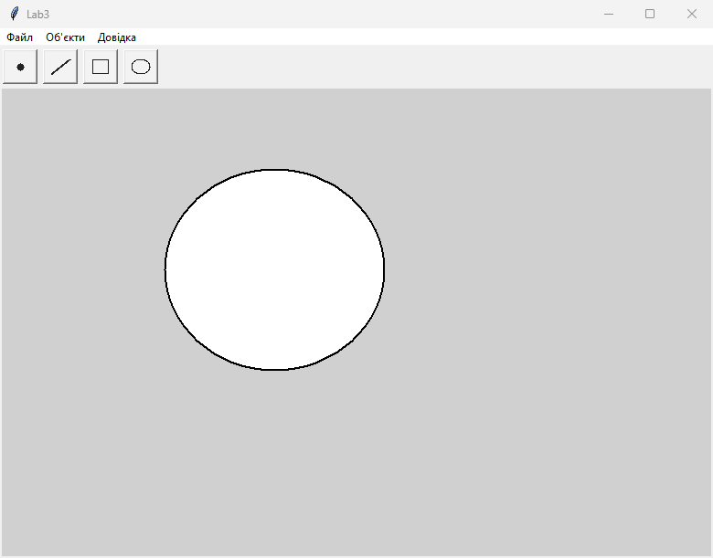
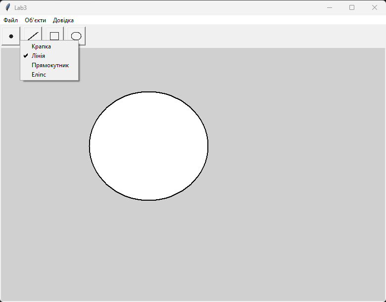

<div style="text-align: center; font-size: 24px; margin-top: 60px;">

Міністерство освіти і науки України

Національний технічний університет України

«Київський політехнічний інститут імені Ігоря Сікорського»

Факультет інформатики та обчислювальної техніки

Кафедра обчислювальної техніки

</div>

<div style="text-align: center; margin-top: 120px;">

<h1 style="font-size: 22px;">Лабораторна робота №3</h1>

<h2 style="font-size: 22px;">з дисципліни «Об'єктно-орієнтоване програмування»</h2>

<h3 style="font-size: 22px; margin-top: 20px;">на тему</h3>

<h2 style="font-size: 22px;">«Розробка інтерфейсу користувача на Python»</h2>

</div>

<div style="text-align: right; margin-top: 120px; font-size: 18px;">

<strong>Виконав:</strong><br>
Кузнецов Кирило Олексійович<br>
студент групи IM-о51<br>
номер у списку групи: 5<br><br>

<strong>Перевірив:</strong><br>
Рекечинський Дмитро Олександрович

</div>

<div style="text-align: center; margin-top: 120px; font-size: 20px;">

Київ 2026

</div>

---
## Завдання

1. Створити у середовищі Microsoft Visual Studio проєкт Python.
2. Написати вихідний текст програми згідно варіанту завдання.
3. Запустити програму і переконатися, що вона працює.
4. Перевірити роботу програми. Налагодити програму.
5. Проаналізувати та прокоментувати результати та вихідний текст програми.
6. Оформити звіт.

---
## Завдання згідно варіанту

Для цієї лаби Ж = Ж лаб2 + 1 = 6.

Список динамічний, бо 6 mod 3 = 0. Місткість N = 106.

Слід суцільний синій (6 mod 4 = 2).

Прямокутник по двох протилежних кутах (6 mod 2 = 0), чорний контур і жовта заливка (6 mod 5 = 1 і 6 mod 6 = 0).

Еліпс від центру до кута (6 mod 2 = 0), чорний контур і біла заливка (6 mod 5 = 1).

Позначка типу - галочка в меню, бо 6 mod 2 = 0. Оновлюю її коли меню відкривають.

Під меню панель кнопок. На кнопці тільки своя іконка, тексту немає. Підказка з'являється коли курсор на кнопці. Іконки лежать поруч із кодом: point.gif, line.gif, rect.gif, ellipse.gif.

Обробники миші, меню і підказки - методи класу MainWin. Підказка висить на методі OnNotify.

---

## Вихідний текст програми

### Lab3.py

```python
import os
from tkinter import *
from tkinter import messagebox

from point import PointShape
from line import LineShape
from rect import RectShape
from ellipse import EllipseShape


class MainWin:
    def __init__(self):
        self.figures = []
        self.N = 106
        self.mode = "крапка"
        self.startx = 0
        self.starty = 0
        self.tyagnu = False
        self.tip = None
        self.pidkazka = {}
        self.imgs = []
        self.checks = {}

        self.win = Tk()
        self.win.title("Lab3")
        self.win.geometry("780x560+60+40")

        here = os.path.dirname(os.path.abspath(__file__))
        # кнопки без тексту, тільки картинка
        self.panel = Frame(self.win)
        self.panel.pack(side=TOP, fill=X)

        self.dodaty_knopku(os.path.join(here, "point.gif"), "Крапка", "крапка")
        self.dodaty_knopku(os.path.join(here, "line.gif"), "Лінія", "лінія")
        self.dodaty_knopku(os.path.join(here, "rect.gif"), "Прямокутник", "прямокутник")
        self.dodaty_knopku(os.path.join(here, "ellipse.gif"), "Еліпс", "еліпс")

        self.c = Canvas(self.win, bg="#d0d0d0")
        self.c.pack(fill=BOTH, expand=True)
        self.c.bind("<ButtonPress-1>", self.on_down)
        self.c.bind("<B1-Motion>", self.on_move)
        self.c.bind("<ButtonRelease-1>", self.on_up)

        menu = Menu(self.win)
        m_file = Menu(menu, tearoff=0)
        m_file.add_command(label="Вихід", command=self.vyhod)
        menu.add_cascade(label="Файл", menu=m_file)

        self.m_obj = Menu(menu, tearoff=0, postcommand=self.on_menu)
        self.dodaty_punkt("Крапка", "крапка")
        self.dodaty_punkt("Лінія", "лінія")
        self.dodaty_punkt("Прямокутник", "прямокутник")
        self.dodaty_punkt("Еліпс", "еліпс")
        menu.add_cascade(label="Об'єкти", menu=self.m_obj)

        m_help = Menu(menu, tearoff=0)
        m_help.add_command(label="Про програму", command=self.pro)
        menu.add_cascade(label="Довідка", menu=m_help)
        self.win.config(menu=menu)
        self.on_menu()

    def dodaty_punkt(self, label, mode):
        v = IntVar(value=0)
        self.checks[mode] = v

        def klik():
            self.set_mode(mode)

        self.m_obj.add_checkbutton(label=label, variable=v, command=klik)

    def dodaty_knopku(self, path, text, mode):
        img = PhotoImage(file=path)
        self.imgs.append(img)

        def klik():
            self.set_mode(mode)

        b = Button(self.panel, image=img, command=klik)
        b.pack(side=LEFT, padx=3, pady=3)
        self.pidkazka[b] = text
        b.bind("<Enter>", self.OnNotify)
        b.bind("<Leave>", self.spryaty_pidkazku)

    def OnNotify(self, e):
        if e.widget in self.pidkazka:
            text = self.pidkazka[e.widget]
        else:
            return
        self.spryaty_pidkazku(None)
        x = e.widget.winfo_rootx() - self.win.winfo_rootx() + 4
        y = e.widget.winfo_rooty() - self.win.winfo_rooty() + e.widget.winfo_height() + 2
        t = Label(self.win, text=text, bg="#fff8c4", relief=SOLID, bd=1)
        t.place(x=x, y=y)
        t.lift()
        self.tip = t

    def spryaty_pidkazku(self, e):
        if self.tip != None:
            self.tip.destroy()
            self.tip = None

    def on_menu(self):
        for mode in self.checks:
            if mode == self.mode:
                self.checks[mode].set(1)
            else:
                self.checks[mode].set(0)

    def set_mode(self, mode):
        self.mode = mode
        self.on_menu()

    def peremaluvaty(self):
        self.c.delete("all")
        for i in range(len(self.figures)):
            self.figures[i].Show(self.c)

    def on_down(self, e):
        self.startx = e.x
        self.starty = e.y
        self.tyagnu = True

    def on_move(self, e):
        if self.tyagnu == False:
            return
        self.c.delete("temp")
        if self.mode == "крапка":
            self.c.create_oval(e.x - 4, e.y - 4, e.x + 4, e.y + 4, outline="blue", tags="temp")
        elif self.mode == "лінія":
            self.c.create_line(self.startx, self.starty, e.x, e.y, fill="blue", width=2, tags="temp")
        elif self.mode == "прямокутник":
            self.c.create_rectangle(self.startx, self.starty, e.x, e.y, outline="blue", width=2, tags="temp")
        elif self.mode == "еліпс":
            dx = e.x - self.startx
            if dx < 0:
                dx = -dx
            dy = e.y - self.starty
            if dy < 0:
                dy = -dy
            self.c.create_oval(self.startx - dx, self.starty - dy, self.startx + dx, self.starty + dy, outline="blue", width=2, tags="temp")

    def on_up(self, e):
        if self.tyagnu == False:
            return
        self.tyagnu = False
        self.c.delete("temp")
        if len(self.figures) >= self.N:
            return

        if self.mode == "крапка":
            obj = PointShape()
            obj.set(e.x, e.y, e.x, e.y)
        elif self.mode == "лінія":
            obj = LineShape()
            obj.set(self.startx, self.starty, e.x, e.y)
        elif self.mode == "прямокутник":
            obj = RectShape()
            obj.set(self.startx, self.starty, e.x, e.y)
        else:
            obj = EllipseShape()
            obj.set(self.startx, self.starty, e.x, e.y)

        self.figures.append(obj)
        self.peremaluvaty()

    def vyhod(self):
        self.win.destroy()

    def pro(self):
        messagebox.showinfo("Довідка", "Lab3. Кузнецов Кирило, група IM-о51")


app = MainWin()

if __name__ == "__main__":
    # ЗАПУСК (PowerShell):
    # cd C:\Users\wyxxn\Desktop\LabsOOPMain\labs\lab3
    # python Lab3.py
    app.win.mainloop()
```

### shape.py

```python
class Shape:
    def __init__(self):
        self.x1 = 0
        self.y1 = 0
        self.x2 = 0
        self.y2 = 0

    def set(self, x1, y1, x2, y2):
        self.x1 = x1
        self.y1 = y1
        self.x2 = x2
        self.y2 = y2

    def Show(self, c):
        pass
```

### point.py

```python
from shape import Shape


class PointShape(Shape):
    def __init__(self):
        Shape.__init__(self)

    def Show(self, c):
        r = 4
        c.create_oval(self.x1 - r, self.y1 - r, self.x1 + r, self.y1 + r, outline="black", fill="black")
```

### line.py

```python
from shape import Shape


class LineShape(Shape):
    def __init__(self):
        Shape.__init__(self)

    def Show(self, c):
        c.create_line(self.x1, self.y1, self.x2, self.y2, fill="black", width=2)
```

### rect.py

```python
# прямокутник по двох кутах, жовта заливка

from shape import Shape


class RectShape(Shape):
    def __init__(self):
        Shape.__init__(self)

    def Show(self, c):
        c.create_rectangle(self.x1, self.y1, self.x2, self.y2, outline="black", fill="yellow", width=2)
```

### ellipse.py

```python
# еліпс від центру, біла заливка

from shape import Shape


class EllipseShape(Shape):
    def __init__(self):
        Shape.__init__(self)

    def Show(self, c):
        x1 = self.x1
        y1 = self.y1
        x2 = self.x2
        y2 = self.y2
        dx = x2 - x1
        if dx < 0:
            dx = -dx
        dy = y2 - y1
        if dy < 0:
            dy = -dy
        c.create_oval(x1 - dx, y1 - dy, x1 + dx, y1 + dy, outline="black", fill="white", width=2)
```

---

## Діаграми

### Діаграма класів

```
Shape
  Show(canvas)
     |
 +---+---+---+
 |   |   |   |
Point Line Rect Ellipse

MainWin
  figures (список, до 106)
  mode
  on_down / on_move / on_up
  OnNotify (підказка)
  on_menu (галочка)
```

---

## Скріншоти

### Рис. 1. Головне вікно і панель кнопок




_Рис. 1. Головне вікно і панель кнопок_

### Рис. 2. Кнопки без підписів, підказка Лінія




_Рис. 2. Кнопки без підписів, підказка Лінія_

### Рис. 3. Прямокутник по кутах, жовта заливка




_Рис. 3. Прямокутник по кутах, жовта заливка_

### Рис. 4. Еліпс від центру, біла заливка




_Рис. 4. Еліпс від центру, біла заливка_

### Рис. 5. Галочка на поточному пункті меню




_Рис. 5. Галочка на поточному пункті меню_

---

## Висновки

Тут я переробив редактор під номер 6. Список вже не забитий наперед, а росте до 106.
Прямокутник став жовтим і по двох кутах, еліпс білий і від центру. Слід синій.
Кнопки на панелі без слів, я намалював свої картинки інструментів. Коли наводжу мишку, вилазить підказка.
Галочка в меню Об'єкти стоїть на тому, що зараз вибрано, і переставляється коли меню відкривається. І з кнопки, і з меню викликається один set_mode.
