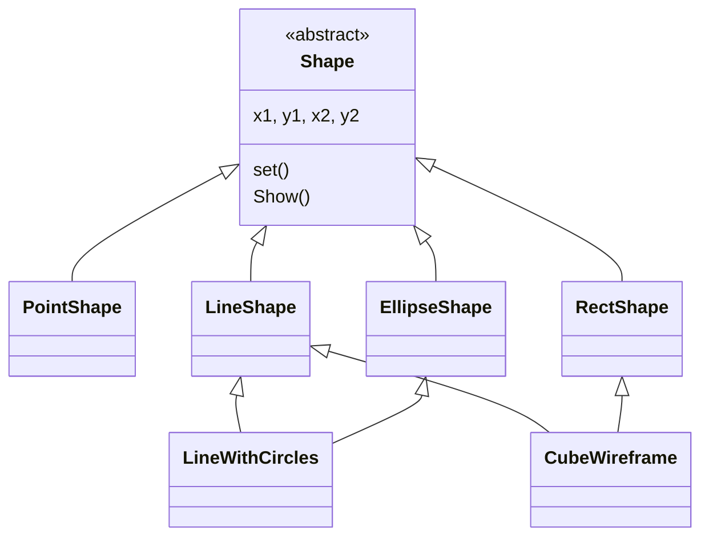
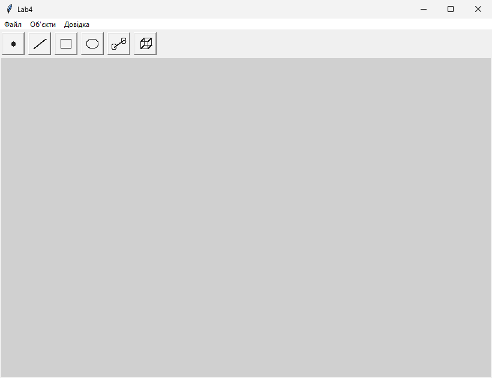
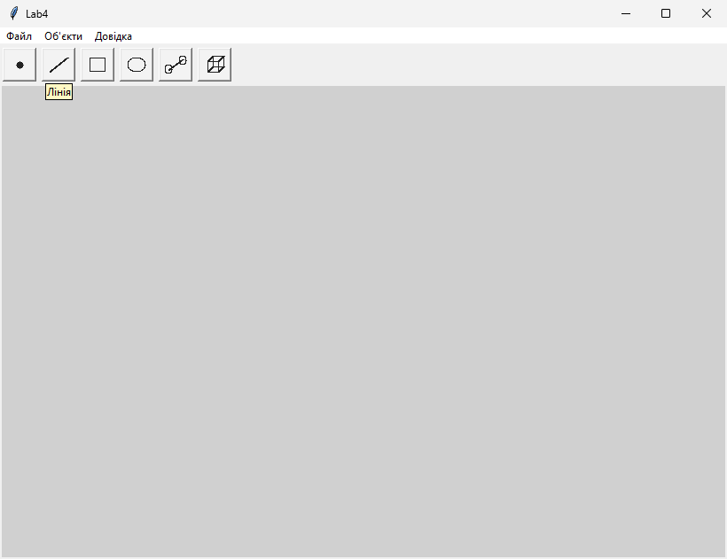
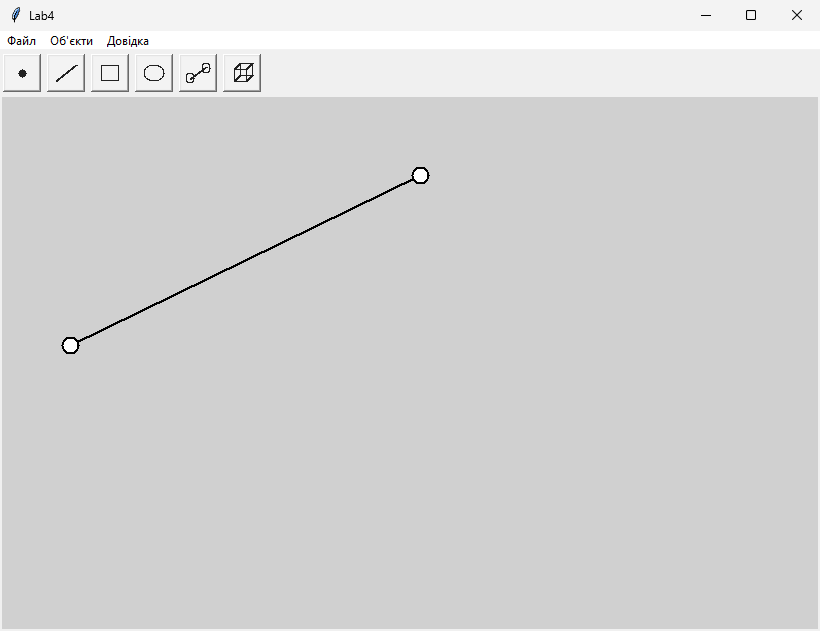
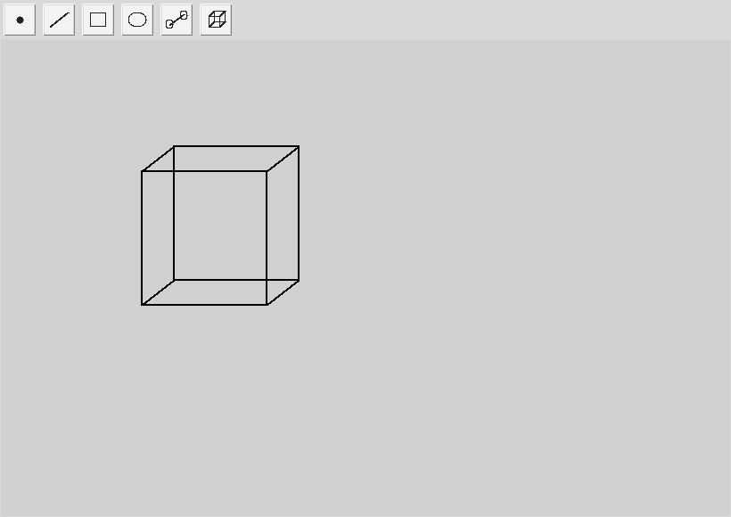
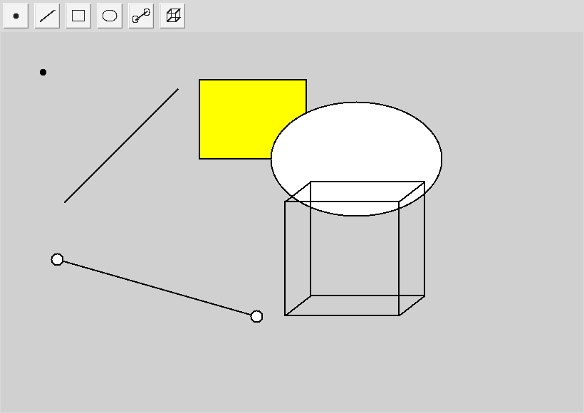

<div style="text-align: center; font-size: 24px; margin-top: 60px;">

Міністерство освіти і науки України

Національний технічний університет України

«Київський політехнічний інститут імені Ігоря Сікорського»

Факультет інформатики та обчислювальної техніки

Кафедра обчислювальної техніки

</div>

<div style="text-align: center; margin-top: 120px;">

<h1 style="font-size: 22px;">Лабораторна робота №4</h1>

<h2 style="font-size: 22px;">з дисципліни «Об'єктно-орієнтоване програмування»</h2>

<h3 style="font-size: 22px; margin-top: 20px;">на тему</h3>

<h2 style="font-size: 22px;">«Вдосконалення структури коду графічного редактора об'єктів на Python»</h2>

</div>

<div style="text-align: right; margin-top: 120px; font-size: 18px;">

<strong>Виконав:</strong><br>
Кузнецов Кирило Олексійович<br>
студент групи IM-о51<br>
номер у списку групи: 5<br><br>

<strong>Перевірив:</strong><br>
Рекечинський Дмитро Олександрович

</div>

<div style="text-align: center; margin-top: 120px; font-size: 20px;">

Київ 2026

</div>

---
## Завдання

1. Створити у середовищі Microsoft Visual Studio проєкт Python.
2. Написати вихідний текст програми згідно варіанту завдання.
3. Запустити програму і переконатися, що вона працює.
4. Перевірити роботу програми. Налагодити програму.
5. Проаналізувати та прокоментувати результати та вихідний текст програми.
6. Оформити звіт.

---
## Завдання згідно варіанту

Тут номер знову Ж = 5, не 6. Номер непарний, тому MyEditor - глобальний статичний об'єкт. Він створюється одразу в editor.py, це ще не Singleton.

Кольори фігур лишив як у лабі 3: прямокутник жовтий по двох кутах, еліпс білий від центру. Гумовий слід усіх фігур тепер пунктир. Колір пунктиру в методичці не названий, синій суцільний з лаби 3 я прибрав, малюю чорним пунктиром. Для сліду викликаю Show з preview=True.

Додав лінію з кружечками і каркас куба. Класи зібрані множинним успадкуванням. У Show нових фігур я не малюю все заново, а кличу Show батьків по імені: LineShape, EllipseShape, RectShape. Грані куба прозорі, щоб було видно всі ребра.

Кнопок на панелі шість, знову тільки іконка і підказка.

---

## Вихідний текст програми

### Lab4.py

```python
from editor import editor

if __name__ == "__main__":
    # ЗАПУСК (PowerShell):
    # cd C:\Users\wyxxn\Desktop\LabsOOPMain\labs\lab4
    # python Lab4.py
    editor.run()
```

### editor.py

```python
import os
from tkinter import *
from tkinter import messagebox

from point import PointShape
from line import LineShape
from rect import RectShape
from ellipse import EllipseShape
from line_circles import LineWithCircles
from cube import CubeWireframe


class MyEditor:
    def __init__(self):
        self.figures = []
        self.N = 106
        self.mode = "крапка"
        self.startx = 0
        self.starty = 0
        self.dragging = False
        self.tip = None
        self.tips = {}
        self.imgs = []
        self.checks = {}
        self.win = None
        self.c = None

    def build(self):
        self.win = Tk()
        self.win.title("Lab4")
        self.win.geometry("820x580+40+30")

        here = os.path.dirname(os.path.abspath(__file__))
        self.panel = Frame(self.win)
        self.panel.pack(side=TOP, fill=X)

        self.add_button(os.path.join(here, "point.gif"), "Крапка", "крапка")
        self.add_button(os.path.join(here, "line.gif"), "Лінія", "лінія")
        self.add_button(os.path.join(here, "rect.gif"), "Прямокутник", "прямокутник")
        self.add_button(os.path.join(here, "ellipse.gif"), "Еліпс", "еліпс")
        self.add_button(os.path.join(here, "linecirc.gif"), "Лінія з кружечками", "лінія з кружечками")
        self.add_button(os.path.join(here, "cube.gif"), "Каркас куба", "каркас куба")

        self.c = Canvas(self.win, bg="#d0d0d0")
        self.c.pack(fill=BOTH, expand=True)
        self.c.bind("<ButtonPress-1>", self.on_down)
        self.c.bind("<B1-Motion>", self.on_move)
        self.c.bind("<ButtonRelease-1>", self.on_up)

        menu = Menu(self.win)
        m_file = Menu(menu, tearoff=0)
        m_file.add_command(label="Вихід", command=self.close_app)
        menu.add_cascade(label="Файл", menu=m_file)

        self.m_obj = Menu(menu, tearoff=0, postcommand=self.on_menu)
        self.add_item("Крапка", "крапка")
        self.add_item("Лінія", "лінія")
        self.add_item("Прямокутник", "прямокутник")
        self.add_item("Еліпс", "еліпс")
        self.add_item("Лінія з кружечками", "лінія з кружечками")
        self.add_item("Каркас куба", "каркас куба")
        menu.add_cascade(label="Об'єкти", menu=self.m_obj)

        m_help = Menu(menu, tearoff=0)
        m_help.add_command(label="Про програму", command=self.about)
        menu.add_cascade(label="Довідка", menu=m_help)
        self.win.config(menu=menu)
        self.on_menu()

    def run(self):
        self.build()
        self.win.mainloop()

    def add_item(self, label, mode):
        v = IntVar(value=0)
        self.checks[mode] = v

        def click():
            self.set_mode(mode)

        self.m_obj.add_checkbutton(label=label, variable=v, command=click)

    def add_button(self, path, text, mode):
        img = PhotoImage(file=path)
        self.imgs.append(img)

        def click():
            self.set_mode(mode)

        b = Button(self.panel, image=img, command=click)
        b.pack(side=LEFT, padx=3, pady=3)
        self.tips[b] = text
        b.bind("<Enter>", self.OnNotify)
        b.bind("<Leave>", self.hide_tip)

    def OnNotify(self, e):
        if e.widget in self.tips:
            text = self.tips[e.widget]
        else:
            return
        self.hide_tip(None)
        x = e.widget.winfo_rootx() - self.win.winfo_rootx() + 4
        y = e.widget.winfo_rooty() - self.win.winfo_rooty() + e.widget.winfo_height() + 2
        t = Label(self.win, text=text, bg="#fff8c4", relief=SOLID, bd=1)
        t.place(x=x, y=y)
        t.lift()
        self.tip = t

    def hide_tip(self, e):
        if self.tip != None:
            self.tip.destroy()
            self.tip = None

    def on_menu(self):
        for mode in self.checks:
            if mode == self.mode:
                self.checks[mode].set(1)
            else:
                self.checks[mode].set(0)

    def set_mode(self, mode):
        self.mode = mode
        self.on_menu()

    def redraw(self):
        self.c.delete("all")
        for i in range(len(self.figures)):
            self.figures[i].Show(self.c)

    def trail(self, x, y):
        self.c.delete("temp")
        self.make_shape(x, y).Show(self.c, preview=True)

    def make_shape(self, x, y):
        if self.mode == "крапка":
            obj = PointShape()
            obj.set(x, y, x, y)
        elif self.mode == "лінія":
            obj = LineShape()
            obj.set(self.startx, self.starty, x, y)
        elif self.mode == "прямокутник":
            obj = RectShape()
            obj.set(self.startx, self.starty, x, y)
        elif self.mode == "еліпс":
            obj = EllipseShape()
            obj.set(self.startx, self.starty, x, y)
        elif self.mode == "лінія з кружечками":
            obj = LineWithCircles()
            obj.set(self.startx, self.starty, x, y)
        else:
            obj = CubeWireframe()
            obj.set(self.startx, self.starty, x, y)
        return obj

    def on_down(self, e):
        self.startx = e.x
        self.starty = e.y
        self.dragging = True

    def on_move(self, e):
        if self.dragging == False:
            return
        self.trail(e.x, e.y)

    def on_up(self, e):
        if self.dragging == False:
            return
        self.dragging = False
        self.c.delete("temp")
        if len(self.figures) >= self.N:
            return
        self.figures.append(self.make_shape(e.x, e.y))
        self.redraw()

    def close_app(self):
        self.win.destroy()

    def about(self):
        messagebox.showinfo("Довідка", "Lab4. Кузнецов Кирило, група IM-о51")


# глобальний статичний об'єкт, ще не singleton
editor = MyEditor()
```

### shape.py

```python
from abc import ABC, abstractmethod


class Shape(ABC):
    def __init__(self):
        self.x1 = 0
        self.y1 = 0
        self.x2 = 0
        self.y2 = 0

    def set(self, x1, y1, x2, y2):
        self.x1 = x1
        self.y1 = y1
        self.x2 = x2
        self.y2 = y2

    @abstractmethod
    def Show(self, c, preview=False):
        pass
```

### point.py

```python
from shape import Shape


class PointShape(Shape):
    def __init__(self):
        Shape.__init__(self)

    def Show(self, c, preview=False):
        r = 4
        fill = "" if preview else "black"
        dash = (4, 3) if preview else ()
        tags = "temp" if preview else ""
        c.create_oval(self.x1 - r, self.y1 - r, self.x1 + r, self.y1 + r,
                      outline="black", fill=fill, dash=dash, tags=tags)
```

### line.py

```python
from shape import Shape


class LineShape(Shape):
    def __init__(self):
        Shape.__init__(self)

    def Show(self, c, preview=False):
        dash = (4, 3) if preview else ()
        tags = "temp" if preview else ""
        c.create_line(self.x1, self.y1, self.x2, self.y2,
                      fill="black", width=2, dash=dash, tags=tags)
```

### rect.py

```python
from shape import Shape


class RectShape(Shape):
    def __init__(self):
        Shape.__init__(self)

    def Show(self, c, preview=False, fill="yellow"):
        if preview:
            fill = ""
        dash = (4, 3) if preview else ()
        tags = "temp" if preview else ""
        c.create_rectangle(self.x1, self.y1, self.x2, self.y2,
                           outline="black", fill=fill, width=2, dash=dash, tags=tags)
```

### ellipse.py

```python
from shape import Shape


class EllipseShape(Shape):
    def __init__(self):
        Shape.__init__(self)

    def Show(self, c, preview=False):
        x1 = self.x1
        y1 = self.y1
        x2 = self.x2
        y2 = self.y2
        dx = x2 - x1
        if dx < 0:
            dx = -dx
        dy = y2 - y1
        if dy < 0:
            dy = -dy
        fill = "" if preview else "white"
        dash = (4, 3) if preview else ()
        tags = "temp" if preview else ""
        c.create_oval(x1 - dx, y1 - dy, x1 + dx, y1 + dy,
                      outline="black", fill=fill, width=2, dash=dash, tags=tags)
```

### line_circles.py

```python
from line import LineShape
from ellipse import EllipseShape


class LineWithCircles(LineShape, EllipseShape):
    def __init__(self):
        LineShape.__init__(self)

    def Show(self, c, preview=False):
        x1 = self.x1
        y1 = self.y1
        x2 = self.x2
        y2 = self.y2
        LineShape.Show(self, c, preview)
        r = 8
        # ліве коло
        self.x1 = x1
        self.y1 = y1
        self.x2 = x1 + r
        self.y2 = y1 + r
        EllipseShape.Show(self, c, preview)
        # праве коло, координати повернути назад
        self.x1 = x2
        self.y1 = y2
        self.x2 = x2 + r
        self.y2 = y2 + r
        EllipseShape.Show(self, c, preview)
        self.x1 = x1
        self.y1 = y1
        self.x2 = x2
        self.y2 = y2
```

### cube.py

```python
from line import LineShape
from rect import RectShape


class CubeWireframe(LineShape, RectShape):
    def __init__(self):
        LineShape.__init__(self)

    def Show(self, c, preview=False):
        x1 = self.x1
        y1 = self.y1
        x2 = self.x2
        y2 = self.y2
        RectShape.Show(self, c, preview, fill="")
        ox = 36
        oy = -28
        self.x1 = x1 + ox
        self.y1 = y1 + oy
        self.x2 = x2 + ox
        self.y2 = y2 + oy
        RectShape.Show(self, c, preview, fill="")
        edges = [
            (x1, y1, x1 + ox, y1 + oy),
            (x2, y1, x2 + ox, y1 + oy),
            (x1, y2, x1 + ox, y2 + oy),
            (x2, y2, x2 + ox, y2 + oy),
        ]
        for i in range(len(edges)):
            self.x1 = edges[i][0]
            self.y1 = edges[i][1]
            self.x2 = edges[i][2]
            self.y2 = edges[i][3]
            LineShape.Show(self, c, preview)
        self.x1 = x1
        self.y1 = y1
        self.x2 = x2
        self.y2 = y2
```

---

## Діаграми

### Діаграма класів



MyEditor - глобальний статичний об'єкт. У ньому є figures, mode та методи on_down, on_move, on_up і redraw.

Обидві гілки нових фігур сходяться в Shape, координати лежать там один раз.

---

## Скріншоти

### Рис. 1. Вікно з шістьма кнопками




_Рис. 1. Вікно з шістьма кнопками_

### Рис. 2. Підказка на кнопці без підпису




_Рис. 2. Підказка на кнопці без підпису_

### Рис. 3. Лінія з кружечками




_Рис. 3. Лінія з кружечками_

### Рис. 4. Каркас куба




_Рис. 4. Каркас куба_

### Рис. 5. Усі шість фігур




_Рис. 5. Усі шість фігур_

---

## Висновки

MyEditor висить одним об'єктом на весь модуль, я його не створюю вдруге.
Дві нові фігури зібрав з уже написаних Show. Лінія з кружечками кличе лінію і еліпс, куб кличе прямокутник і лінію. Копіювати формули малювання не довелось.
Слід тепер пунктирний у всіх інструментів. Кольори старих фігур не чіпав, вони як у попередній лабі.
Кнопок стало шість, підписів на них немає.
